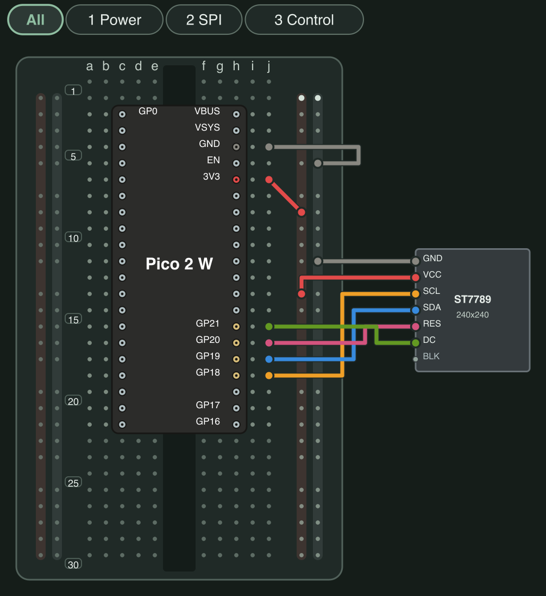

# Pico 2 W + ST7789 breadboard wiring

This [BreadKit](https://github.com/breadkit/breadkit) diagram follows the layout and visual conventions of [05_sensor_demo.bk.rb](https://github.com/breadkit/breadkit/blob/main/examples/05_sensor_demo.bk.rb), adapted to pico2w3d's default configuration.
It targets a 3.3V-compatible, seven-pin ST7789 240×240 display without CS.
The diagram uses a dark theme, a dark Pico 2 W body, short signal-name labels, and the example's wire palette. Power, SPI, and control wiring are separate layers.



[Interactive HTML with layers and zoom](pico2w3d.html) / [SVG](pico2w3d.svg) / [Editable BreadKit source](pico2w3d.bk.rb)

## Reading the diagram

Place the Pico 2 W across the breadboard's central gap with its USB connector facing up.
Physical pin 1 goes into c3, and physical pin 40 goes into h3.
Labels on the Pico 2 W show signal names; the numbers along the breadboard's left edge are hole row numbers. Physical pin numbers are listed in the table below.

Use eight jumper wires.
Connect the Pico 2 W's 3V3(OUT) and GND to the right-hand power rails, then connect the display to those rails.
On the right side of this diagram, the inner rail is 3.3V and the outer rail is GND.
Crossing wires are not connected to each other.

| Wire color | Pico 2 W | Physical pin | Breadboard hole | Display |
|---|---|---:|---|---|
| Red | 3V3(OUT) | 36 | j7 → 3.3V rail | VCC |
| Gray | GND | 38 | j5 → GND rail | GND |
| Orange | GP18 | 24 | j19 | SCL / SCK / CLK |
| Blue | GP19 | 25 | j18 | SDA / DIN / MOSI |
| Pink | GP20 | 26 | j17 | RES / RST |
| Green | GP21 | 27 | j16 | DC / A0 |

The display's terminal order is illustrative. Match the printed signal names on your module when wiring it.
Leave BLK disconnected until you have checked the module specifications.
GP16, GP17, VBUS, and VSYS also have no external wiring in this diagram.
For a display with CS, follow the [project's wiring and configuration instructions](../README.md#wiring).

Supply power through the Pico 2 W's USB connector, and unplug USB before changing wiring.
`PICO_3V3_REGULATOR` in the source represents the Pico 2 W's 3.3V output for electrical checks; it does not call for an external power supply.

## Validate and regenerate

Install BreadKit's rendering and lint tools with Ruby 3.3 or newer, then run these commands from the project root.
PNG conversion uses `rsvg-convert` from librsvg. Its background matches the dark HTML viewer.

```sh
gem install breadkit-render breadkit-lint
bklint wiring/pico2w3d.bk.rb
bkrender wiring/pico2w3d.bk.rb --theme dark --crop none -o wiring/pico2w3d.svg
bkrender wiring/pico2w3d.bk.rb --theme dark --crop none -o wiring/pico2w3d.html
rsvg-convert --zoom=3 --background-color='#151d19' wiring/pico2w3d.svg -o wiring/pico2w3d.png
```

The files were generated on 2026-10-28 using local checkouts of BreadKit `30e6f9f` and breadkit-render `9a1c5e9`. The PNG's labels and wire routing were visually inspected.
`bklint` reports zero errors and zero warnings.
The source's `expect` block checks all six signal and power connections, along with isolation between distinct nets.
Checks also reject intentional SCL-to-MOSI and GND-to-3.3V wiring errors.
One informational `Electrical/DcBoundsIncomplete` message remains because current and power consumption are not modeled.
These checks do not establish hardware operation or electrical safety. HTML browser interaction remains untested because the browser connection was unavailable.

The [Pico 2 W definition](parts/pico_2_w.yml) retains the compatible 40-pin header map from [breadkit-parts](https://github.com/breadkit/breadkit-parts/blob/main/parts/raspberry_pi_pico_w.yml) at `6ccff4d`, with the board identity, display labels, and body colors updated.
Its pin assignments follow the [official Pico 2 W pinout](https://datasheets.raspberrypi.com/picow/pico-2-w-pinout.pdf).
The example uses a different RP2040 board; this diagram keeps the Pico 2 W's actual pin assignments.
The part definition's license is included in [parts/LICENSE.txt](parts/LICENSE.txt).
